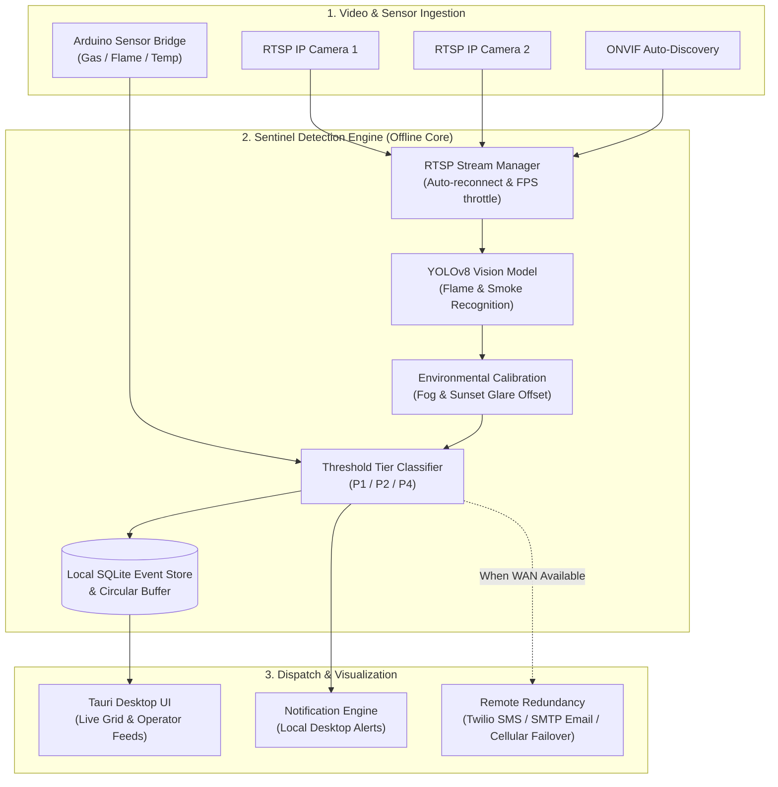

<div align="center">

# 🔥 Sentinel Fire Detection System

**An open-source, supplementary early-warning fire and smoke detection platform powered by computer vision and edge computing.**

[](LICENSE)
[](https://www.python.org/)
[](https://tauri.app/)
[](https://reactjs.org/)
[]()
[](CONTRIBUTING.md)

</div>

---

> [!WARNING]
> ### ⚠️ SAFETY, REGULATORY & USAGE QUALIFIER
> **Sentinel is an open-source SUPPLEMENTARY early-warning and research platform.**
> - **DOES NOT REPLACE CERTIFIED FIRE ALARM SYSTEMS**: Sentinel is **NOT** a certified primary fire detection or life safety system under NFPA 72 (National Fire Alarm and Signaling Code), EN 54, UL 268, or local building/fire codes.
> - **NEVER USE AS SOLE DETECTION**: Sentinel must **NEVER** be relied upon as the sole or primary life safety warning system for homes, workplaces, or sleeping areas.
> - **MAINTAIN CERTIFIED SYSTEMS**: Always maintain operational, code-compliant, certified smoke and fire alarm systems.
> - **SUPPLEMENTARY SITUATIONAL AWARENESS ONLY**: Sentinel is designed to add an extra layer of spatial situational awareness and early optical warning in large spaces (e.g., warehouses, loading bays, outdoor yards, industrial halls) where smoke plumes may be optically detected before reaching point sensors.
> - **AS-IS SOFTWARE**: As provided under the Apache 2.0 License, this software is distributed without warranties or conditions of any kind. See [LICENSE](LICENSE) for full legal disclaimers.

---

## 📑 Table of Contents

- [Overview & Architecture](#-overview--architecture)
- [Key Features](#-key-features)
- [Project Evolution & History (Past 1–2 Years)](#-project-evolution--history)
- [System Requirements](#-system-requirements)
- [Quick Start - Development](#-quick-start---development)
- [Production Deployment](#-production-deployment)
- [Configuration & Threshold Tuning](#-configuration--threshold-tuning)
- [Testing & Validation](#-testing--validation)
- [Hardware & Sensor Fusion](#-hardware--sensor-fusion)
- [Contributing](#-contributing)
- [License](#-license)
- [Contributors](#-contributors)

---

## 🏛 Overview & Architecture

Sentinel combines real-time computer vision (custom-trained YOLOv8 models) with native hardware integrations and edge computing to monitor standard RGB security camera streams (RTSP / ONVIF). It operates completely offline, ensuring continuous local surveillance even during external internet or power grid outages.



---

## ✨ Key Features

- **Real-Time Visual Detection**: Fast inference for flame and smoke patterns optimized for edge GPUs and multi-camera streams.
- **Offline-First Resilience**: Zero dependency on third-party cloud services for core fire monitoring, video buffering, and local audio/visual alarms.
- **Multi-Camera Concurrency**: Efficient concurrent RTSP feed processing with automatic connection health scoring, reconnect backoff, and frame rate optimization.
- **Intelligent Environmental Compensation**:
  - **Sunset Glare Suppression**: Dynamic threshold adaptation during low-angle twilight hours to prevent false positives from solar glare.
  - **Atmospheric / Fog Filtering**: Reduced sensitivity in dense particulate and steam conditions.
  - **Sensor Degradation Monitoring**: Identifies dirty lenses, occlusions, and camera feed drops.
- **Tiered Incident Classification**:
  - **P1 (Immediate Critical Alert)**: Instant siren, operator alert, and dispatch notification ($confidence \ge 0.95$).
  - **P2 (Review Queue)**: Human-in-the-loop verification for suspicious signatures ($0.85 \le confidence < 0.95$).
  - **P4 (Telemetry Logging)**: Ambient telemetry logging for continuous model evaluation ($0.70 \le confidence < 0.85$).
- **Dual-Network Redundancy**: Automatic failover between primary Ethernet, Wi-Fi, and 4G/LTE cellular backup.
- **Cross-Platform Native Desktop Client**: Lightweight, secure desktop application built with Tauri v2, Rust, React 18, and TailwindCSS.

---

## 📜 Project Evolution & History

Sentinel originated as an internal industrial safety research effort and evolved through field trials into a robust open-source supplementary platform:

```
2023: Inception & Prototyping
  └── YOLOv8 fire/smoke recognition proof of concept
  └── Tauri v1 desktop wrapper & local SQLite event database

2024: Edge Hardening & Industrial Deployments
  ├── Q1-Q2: Real RTSP streaming, ONVIF discovery, Arduino sensor bridge
  ├── Q3: 72-hour continuous endurance stress tests & GPU thermal mitigation
  ├── Q3: Dual-network cellular failover & 1M-event SQLite performance validation
  └── Q4: Camera health scoring, predictive maintenance alerts, Grafana telemetry

2025: Open-Source Transition
  ├── Complete codebase migration from internal GitLab to GitHub
  ├── Production Linux systemd and Windows service installer suites
  └── Modular alert notification pipelines & multi-site configurations

2026: Modernization & Community Release
  ├── Tauri v2 architecture migration & security hardening
  └── Comprehensive open-source test suite, documentation, and contribution guidelines
```

### Key Milestones
- **Q3 2023 - Phase 1 Foundation**: Initial implementation of the YOLOv8 visual detection pipeline, Tauri desktop shell, and hot-reloading YAML configuration system.
- **Early 2024 - Sensor Fusion & Streaming**: Added the Arduino hardware bridge for MQ-2/MQ-135 combustion gas and IR flame sensors, alongside ONVIF camera discovery.
- **Mid-to-Late 2024 - Industrial Hardening**: Tested 72-hour continuous operation without memory degradation across 10+ concurrent video feeds. Implemented GPU thermal throttling safeguards and automated network failover.
- **Late 2025 - Open-Source Migration**: Migrated 190+ commits and development artifacts from internal GitLab repositories to GitHub, cleaning internal data and establishing open documentation.
- **2026 - Active Maintenance**: Transitioned to Tauri v2, modernized build dependencies, and published complete developer guides.

---

## 💻 System Requirements

| Component | Minimum (Dev / Small Site) | Recommended (Production 10+ Cameras) |
| :--- | :--- | :--- |
| **Processor** | Intel Core i5 / AMD Ryzen 5 / Apple M1 | Intel Core i7 / Xeon / AMD Ryzen 7 (8+ cores) |
| **Memory** | 8 GB RAM | 16 GB – 32 GB RAM |
| **GPU** | Integrated Graphics (simulated / test feeds) | NVIDIA RTX 3060+ (CUDA 11.8+ / 12.0+) |
| **Storage** | 20 GB free SSD storage | 512 GB+ NVMe SSD (high-write endurance) |
| **Network** | 100 Mbps LAN | Dual Gigabit Ethernet + optional 4G/LTE Modem |
| **OS** | Linux, Windows 10/11, macOS 12+ | Ubuntu Server 22.04 / 24.04 LTS or Windows 10/11 Pro |

See [`docs/requirements.md`](docs/requirements.md) for detailed hardware benchmarks.

---

## 🚀 Quick Start - Development

### 1. Prerequisites
- **Python 3.10+**
- **Node.js 18+ (LTS)** and `npm`
- **Rust & Cargo** (latest stable: `curl --proto '=https' --tlsv1.2 -sSf https://sh.rustup.rs | sh`)

### 2. Clone & Setup
```bash
# Clone the repository
git clone https://github.com/benjaminxie1/sentinel-app.git
cd sentinel-app

# Setup Python virtual environment
python3 -m venv venv
source venv/bin/activate  # On Windows: .\venv\Scripts\activate
pip install -r requirements.txt

# Install Node dependencies
npm install
```

### 3. Launch Development Mode
```bash
# Start the full stack application (Tauri frontend + Python detection engine)
npm run tauri dev
```

---

## 🏭 Production Deployment

Sentinel includes automated production installation scripts that configure background daemons/services for unattended 24/7 operation.

### Linux (Ubuntu / Debian / systemd)
```bash
# Run the automated installer (installs dependencies and sets up systemd daemon)
sudo ./scripts/install.sh

# Edit site configurations
sudo nano /etc/sentinel/detection_config.yaml
sudo nano /etc/sentinel/cameras.yaml

# Manage service
sudo systemctl status sentinel-fire-detection
sudo systemctl restart sentinel-fire-detection
```

### Windows (Windows Service / Task Scheduler)
```powershell
# Run PowerShell as Administrator
.\scripts\install.ps1

# Start the background service
Start-Service -Name "SentinelFireDetection"
```

---

## ⚙️ Configuration & Threshold Tuning

All runtime parameters can be adjusted without rebuilding the application via [`config/detection_config.yaml`](config/detection_config.yaml):

```yaml
detection:
  thresholds:
    immediate_alert: 0.95    # P1: Immediate dispatch / high-priority alarm
    review_queue: 0.85       # P2: Human verification queue
    log_only: 0.70           # P4: Informational telemetry logging

  environmental:
    fog_adjustment: -0.05    # Sensitivity offset in fog/steam
    sunset_hours: [17, 19]   # Glare compensation window (5 PM - 7 PM)

cameras:
  max_concurrent: 10         # Parallel camera processing limit
  frame_rate: 2              # Target inference FPS per feed (reduces GPU thermals)
  rtsp_timeout: 5            # Seconds before stream reconnect attempt

system:
  detection_latency_target: 2.0  # Target latency limit in seconds
  log_retention_days: 30
  video_retention_hours: 48
```

For RTSP and IP camera connection examples, refer to the [`docs/RTSP_SETUP.md`](docs/RTSP_SETUP.md) guide.

---

## 🧪 Testing & Validation

Run unit tests and verification suites locally:

```bash
# Run unit and model detection tests
pytest tests/

# Validate configuration files
python scripts/validate_config.py

# Benchmark camera stream inference latency
python scripts/benchmark.py
```

---

## 🔌 Hardware & Sensor Fusion

Sentinel supports multi-sensor fusion via an optional Arduino / microcontroller bridge:
- **Combustion Gas Detection**: MQ-2 and MQ-135 analog gas sensors
- **Infrared Flame Spectrum**: 760nm–1100nm optical flame photodiode modules
- **Rate-of-Rise Thermal**: DHT22 / BME280 temperature rate-of-rise alarms

See [`docs/hardware_integration.md`](docs/hardware_integration.md) for full schematics and pinouts.

---

## 🤝 Contributing & Governance

Contributions from the open-source community are warmly welcome! Please read our [Contributing Guide](CONTRIBUTING.md) for coding standards, pull request processes, and safety design considerations.

For maintainer responsibilities, issue triage SLAs, and release cadence, see [MAINTAINERS.md](MAINTAINERS.md). Detailed version history is available in the [CHANGELOG.md](CHANGELOG.md).

1. Fork the repo (`git checkout -b feature/amazing-feature`)
2. Commit your changes (`git commit -m 'feat: add feature'`)
3. Push to your branch (`git push origin feature/amazing-feature`)
4. Open a Pull Request

---

## 📄 License

Sentinel is distributed under the **Apache License 2.0**. See the [LICENSE](LICENSE) file for details.

---

## 👥 Contributors & Acknowledgments

- **[Benjamin Xie](https://github.com/benjaminxie1)** - Project Lead & Core Architecture
- **[Kevin Fei](https://github.com/Fairhain)** - Hardware Integration & Systems Engineering
- **[Mihir Bamdhamvamvuri](https://github.com/Phenixrigh)** - Detection Models & Field Testing
